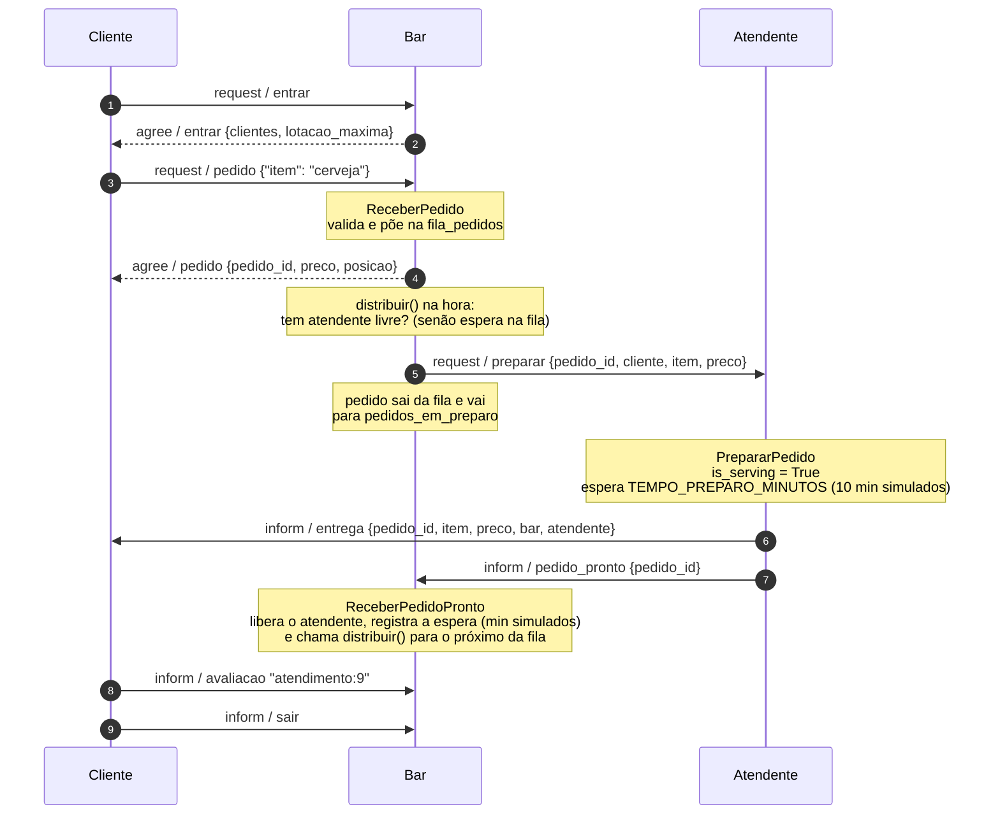
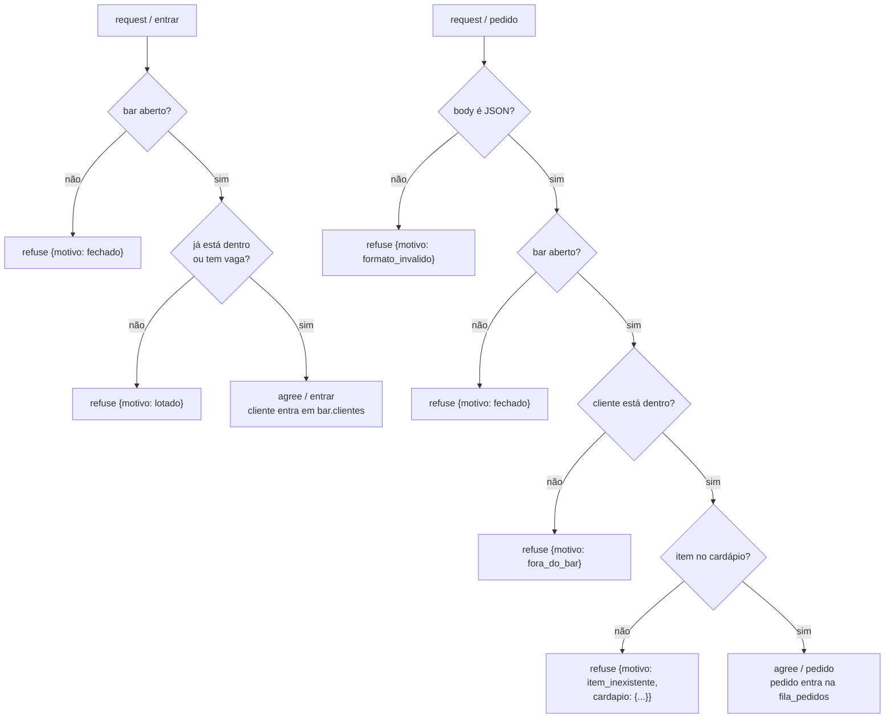
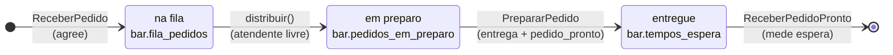

# Bar SMA

Simulação de bares com agentes [SPADE](https://spade-mas.readthedocs.io/): cada **Bar** cria seus **Atendentes** e **Faxineiras**, e **Clientes** entram, pedem, avaliam e saem, tudo por troca de mensagens.

```bash
source .venv/bin/activate
pip install -r requirements.txt
python main.py               # 3 bares, 30 dias simulados, 1 dia = 60 s (mês em 30 min)
python main.py --dia 2       # acelerado: 1 dia = 2 s (mês em 1 min)
python main.py --dia 5 --dias 7   # só 1 semana, 1 dia = 5 s
```

Painel: http://127.0.0.1:10000/painel (mostra dia, hora e semana da simulação).

---

## Tempo da simulação

Todo tempo é **simulado** e passa pelo [relogio.py](relogio.py): `relogio.minutos(10)`, `relogio.horas(1)`, `relogio.semanas(1)` devolvem quantos segundos **reais** isso dura na escala atual. Por isso mudar `--dia` acelera ou desacelera tudo por igual.

| 1 dia = | 1 semana | 1 mês |
|---|---|---|
| 60 s (padrão) | 7 min | 30 min |
| 5 s | 35 s | 2,5 min |
| 2 s | 14 s | 1 min |

- O relógio só começa **depois** que todos os agentes sobem; ao fim de `--dias` a simulação encerra sozinha.
- Escala abaixo de ~2 s/dia começa a distorcer: o atraso real das mensagens XMPP (alguns ms) não acelera junto.
- Ao criar algo com duração, use o relógio, nunca segundos fixos: `asyncio.sleep(relogio.minutos(10))`.

---

## Fluxo de pedidos

### Visão geral



### Quando o bar recusa



### Vida de um pedido



---

## Mensagens

Toda mensagem tem `performative` + `ontology`. O bar só entrega cada mensagem ao behaviour cujo `Template` bate com esses dois valores; **mensagem sem `ontology` é ignorada sem erro**.

| De → Para | performative | ontology | body (JSON) | Resposta |
|---|---|---|---|---|
| Cliente → Bar | `request` | `entrar` | — | `agree` `{clientes, lotacao_maxima}` · `refuse` `{motivo}` |
| Cliente → Bar | `request` | `pedido` | `{"item": "cerveja"}` | `agree` `{pedido_id, item, preco, posicao}` · `refuse` `{motivo}` |
| Bar → Atendente | `request` | `preparar` | `{pedido_id, cliente, item, preco}` | — |
| Atendente → Cliente | `inform` | `entrega` | `{pedido_id, item, preco, bar, atendente}` | — |
| Atendente → Bar | `inform` | `pedido_pronto` | `{pedido_id}` | — |
| Cliente → Bar | `query-ref` | `avaliacao` | — | `inform` `{bar, nota_geral, pontuacao, num_avaliacoes}` |
| Cliente → Bar | `inform` | `avaliacao` | `"criterio:nota"` (texto, ex. `preco:7`) | — |
| Cliente → Bar | `inform` | `sair` | — | — |

**Cardápio** (`CARDAPIO` em `agents/Bar.py`): `cerveja` 12 · `refrigerante` 6 · `drink` 25 · `porcao` 30

### Exemplo: cliente pedindo uma cerveja

```python
import json
from spade.message import Message

msg = Message(to="bar1@localhost")
msg.set_metadata("performative", "request")
msg.set_metadata("ontology", "pedido")
msg.body = json.dumps({"item": "cerveja"})
await self.send(msg)

resp = await self.receive(timeout=5)          # agree ou refuse
dados = json.loads(resp.body)                 # {"pedido_id": 1, "preco": 12, ...}
```

---
